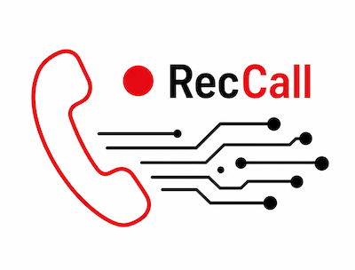

<div align="center">

<picture>
  <source media="(prefers-color-scheme: dark)" srcset="logos/rec_call_logo_dark_01.png" />
  
</picture>

<p><strong>Record macOS calls — your microphone + the meeting audio — into a single stereo WAV.</strong></p>

<p>
  
  
  
  
  <a href="LICENSE"></a>
</p>

🇬🇧 **English** &nbsp;·&nbsp; 🇧🇷 [Português](README.pt-BR.md)

</div>

---

RecCall captures your microphone and the meeting audio (via [BlackHole](https://existential.audio/blackhole/)) and mixes them into one stereo WAV — **your voice on the left channel, the call on the right** — all from a small local web app.

## Features

- 🎙️ **One‑take stereo recording** — microphone on the left channel, meeting audio on the right.
- 📊 **Live spectrum** driven by the real audio (streamed from the server over a WebSocket), with a big timer and a status icon that blinks while paused.
- ▶️ **Integrated player** — saved recordings play back in the same display, with a real spectrum and a per‑row play / pause toggle.
- 🗂️ **Recordings list** — sequential id, duration, quality, modified date/time, download and delete (with confirmation), **paginated**.
- 🎚️ **Configurable quality** — sample rate (auto‑negotiated or forced) and bit depth (16/24‑bit PCM or 32‑bit float).
- 🌗 **Light / dark themes** with a matching logo per theme.
- 🌐 **Bilingual UI** — English & Brazilian Portuguese, switchable on the fly.
- ✅ **100% backend test coverage** (PortAudio mocked, no hardware needed).

## Table of contents

- [Requirements](#requirements)
- [Installation](#installation)
- [Audio setup](#audio-setup)
- [Using the app](#using-the-app)
- [File format](#file-format)
- [Docker](#docker)
- [Development](#development)
- [License](#license)

## Requirements

- **macOS** with [Homebrew](https://brew.sh/), and [uv](https://docs.astral.sh/uv/) to run the app.
- **[BlackHole 2ch](https://existential.audio/blackhole/)** — a virtual audio driver used to capture the meeting audio. Without it there is no meeting‑audio device to record from.

> [!IMPORTANT]
> Docker Desktop on macOS runs inside a Linux VM and has no direct access to CoreAudio devices (microphone, AirPods, DJI Mic 2, BlackHole). **Run RecCall directly on the macOS host to capture audio.** The Docker setup is only for packaging the interface/API.

## Installation

### 1. Install BlackHole and the native libraries

```bash
brew install blackhole-2ch portaudio libsndfile
```

This installs BlackHole 2ch together with the PortAudio and libsndfile libraries RecCall depends on.

> [!NOTE]
> After installing BlackHole you may need to log out and back in (or reboot) for macOS to register the new audio device.

### 2. Install uv and run RecCall

```bash
# install uv (skip if you already have it)
curl -LsSf https://astral.sh/uv/install.sh | sh

cd RecCall
uv sync          # creates the .venv and installs dependencies from uv.lock
uv run reccall   # starts the server
```

`uv sync` reads `pyproject.toml` / `uv.lock` and uses the Python pinned in `.python-version` (3.12), downloading it automatically if needed.

Then open **<http://localhost:5055>**.

## Audio setup

Installing BlackHole on its own is not enough — it is just a "virtual audio cable". You need to route the meeting audio to **both** your headphones (so you can hear it) **and** BlackHole (so RecCall can capture it).

**1. Create a Multi‑Output Device**

1. Open **Audio MIDI Setup** (search with Spotlight).
2. Click the **`+`** in the bottom‑left → **Create Multi‑Output Device**.
3. Tick **both**: your real headphones/speakers **and** `BlackHole 2ch`.
4. (Recommended) Enable **Drift Correction** on the BlackHole row.

**2. Send the meeting audio to it**

- **Globally:** in the macOS sound menu (or System Settings → Sound → Output), pick the **Multi‑Output Device**.
- **Per app:** inside Zoom/Teams/Meet, set the **Multi‑Output Device** as the *Speaker/Output*.

**3. Pick the devices in RecCall** (⚙ Settings, top‑right):

| Setting | Goes to | Notes |
| --- | --- | --- |
| **Microphone** | left channel | `macOS Default Input` or a real mic. If AirPods are also your output, use the built‑in mic — macOS makes the AirPods mic unavailable while they play audio. |
| **Meeting audio / BlackHole** | right channel | pick **`BlackHole 2ch`**. |
| **Sound quality** | — | sample rate (`Auto` negotiates the best common rate) and bit depth. |

> [!WARNING]
> The Multi‑Output Device is only for the **output** (the sound you hear). Your microphone is captured separately — do **not** merge mic + BlackHole into an "Aggregate Device", as RecCall already mixes the two into the stereo channels.

## Using the app

**Recorder.** The selected mic, meeting device and quality show as chips next to the **Recorder** title. Hit **Record** to start — the timer runs, the status icon turns red, and the spectrum reacts to the real audio. **Pause** freezes and blinks the timer, **Resume** continues, **Stop** finalises the WAV.

**Playback.** In **Saved recordings** the play button is the first column after the id. It plays the recording **inside the recorder display** (shared spectrum and timer) and turns into a pause button. **Close** returns to recording mode.

**Recordings list.** Columns: `#`, file, length, quality, size, modified (date over time), and actions (download, delete with confirmation). Paginated — change *Items per page* in Settings.

**Settings, language & theme.** The **⚙ gear** opens devices + sound quality + page size; the **PT/EN** button switches the interface language, and the **sun/moon** toggles light/dark — all remembered across reloads.

## File format

Recordings are saved to `recordings/YYYY-MM-DD/RecCall_YYYYMMDD_HHMMSS.wav`:

- WAV, **stereo** — left channel: microphone · right channel: meeting audio / BlackHole;
- bit depth selectable in **Settings → Sound quality** (16‑bit PCM by default; 24‑bit PCM or 32‑bit float);
- sample rate auto‑negotiated to the highest both devices support (48 kHz when available), or forced from Settings.

## Docker

```bash
docker compose up --build
```

On macOS this mainly validates the interface/API — audio capture won't work inside the Docker VM. On Linux with ALSA/PulseAudio devices mapped through, capture can work by adapting `docker-compose.yml`.

## Development

```text
backend/app/
  main.py          FastAPI app: REST routes, /ws/spectrum, static mount
  recorder.py      recording engine (sounddevice + soundfile), spectrum FFT
  static/          web UI — vanilla HTML/CSS/JS, no build step
tests/             pytest suite (PortAudio mocked)
pyproject.toml     deps + project config (managed by uv)
```

The frontend is plain HTML/CSS/JS served by FastAPI — no bundler. In dev the server sends `Cache-Control: no-cache` for static assets, and asset URLs carry a `?v=` query, so edits show up on a normal reload.

```bash
uv lock --upgrade   # bump all dependencies to the latest releases
uv sync
uv run pytest       # backend tests — enforces 100% line coverage
```

## License

[MIT](LICENSE) © Gustavo Schaedler
